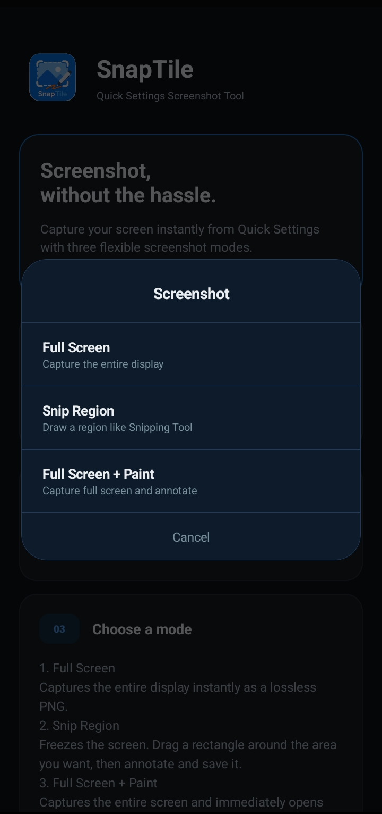
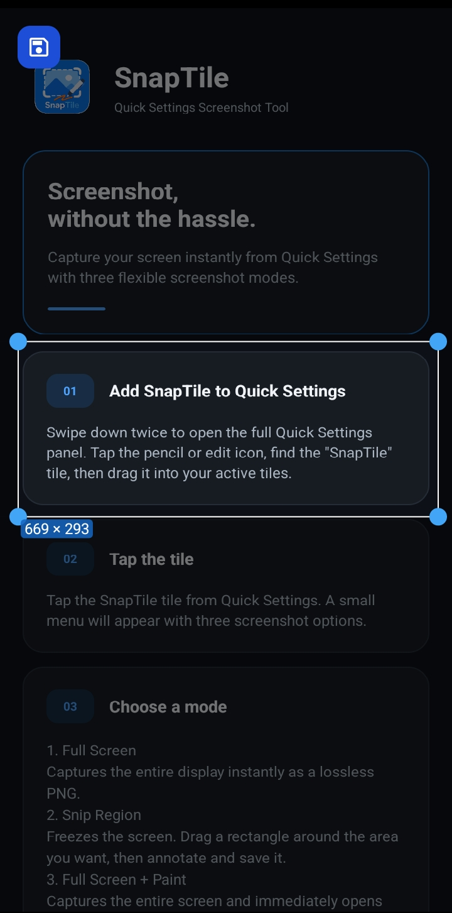
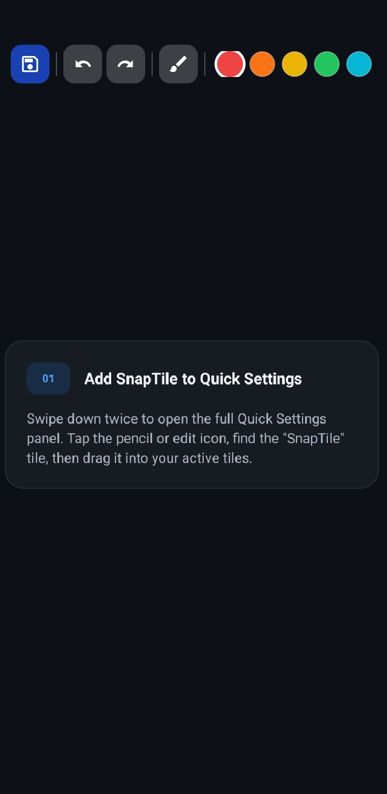

# SnapTile

**Lightweight screenshot and snipping tool for Android.**  
*Capture your screen from Quick Settings, select a region, annotate it, and save it as a lossless PNG.*

[](LICENSE)
[](https://android.com)
[]()
[]()

<p align="center">
  <a href="https://github.com/hashierholmes/SnapTile/releases/latest">
    
  </a>
</p>

---

## Overview

**SnapTile** is a lightweight Android screenshot utility built around the system Quick Settings panel.

It provides three capture modes:

- **Full Screen** — captures the entire display and saves it as a lossless PNG.
- **Snip Region** — captures the display, allows the user to select a specific region, and opens the paint editor.
- **Full Screen + Paint** — captures the entire display and opens the paint editor immediately.

SnapTile supports two capture paths. When its Accessibility service is enabled, it uses Android's accessibility screenshot APIs where supported, avoiding the MediaProjection consent prompt. When Accessibility is disabled, the Quick Settings tile still works: each capture opens Android's MediaProjection consent dialog before taking the screenshot. Accessibility is optional; users can choose the privacy/compatibility trade-off that works for them.

SnapTile does not require a backend, network connection, account, or third-party service.

---

## Screenshots

<p align="center">
  
  &nbsp;&nbsp;
  
  &nbsp;&nbsp;
  
</p>

---

## Features

- **Quick Settings Integration** — Launch screenshot capture directly from Android Quick Settings.
- **Full Screen Capture** — Capture the entire display as a lossless PNG.
- **Interactive Snipping Tool** — Select, move, resize, or replace a screenshot region before editing.
- **Paint Annotation** — Draw directly over captured screenshots using configurable brush sizes and colors.
- **Undo / Redo** — Reverse or restore individual paint strokes without modifying the original bitmap.
- **Multiple Capture Modes** — Choose between full-screen capture, region selection, or full-screen capture with immediate editing.
- **Native Android Implementation** — Built primarily with Android framework APIs and Java.
- **Lossless PNG Output** — Screenshots are saved as PNG files to preserve image quality.
- **Native MediaStore Support** — Uses Android's modern shared-media APIs on supported Android versions.
- **Offline Operation** — Core screenshot and editing functionality does not require network access.
- **Minimal Permissions** — SnapTile does not request unnecessary network or account-related permissions.

---

## Architecture

```text
[ Android Quick Settings ]
            │
            ▼
[ ScreenshotTileService ]
            │
            ▼
[ ScreenshotChooserActivity ] ──► capture mode
            │
            ▼
[ CapturePrefs.request() ] ──► which capture method?
            │
   ┌────────┴───────────────────────────┐
   ▼                                    ▼
[ Native ]                         [ Legacy ]
[ ScreenshotAccessibilityService ] [ CaptureActivity ]
   │                                   │
   │ full screen:                      │ MediaProjection consent
   │ GLOBAL_ACTION_TAKE_SCREENSHOT     ▼
   │ → the system saves the shot   [ ProjectionService ]
   │                                   │ foreground service
   │ region / paint:                   ▼
   └──────────────► [ VirtualDisplay + ImageReader ]
                        │
                   Single Frame
                        │
                    [ Bitmap ]
                        │
       ┌────────────────┼────────────────┐
       ▼                ▼                ▼
  Full Screen     [ SnipActivity ]   Full + Paint
                  Region / Paint
                        │
                        ▼
                  [ ImageSaver ]
                        │
                        ▼
               Pictures/Screenshots/
```

---

## Components

| Component | Responsibility |
| :--- | :--- |
| `MainActivity` | Provides the launcher/setup screen, the capture-method card, and developer credit. |
| `ScreenshotTileService` | Exposes SnapTile through Android Quick Settings. |
| `ScreenshotChooserActivity` | Allows the user to select the desired capture mode. |
| `CapturePrefs` | Stores the chosen capture method and routes every capture request by it. |
| `ScreenshotAccessibilityService` | The native capture path: system screenshot action for full screen, and the fallback into MediaProjection for region/paint or older releases. |
| `AccessibilitySetupActivity` | The how-to-enable screen, including the restricted-settings step Android hides from side-loaded apps. |
| `CaptureActivity` | Handles MediaProjection authorization, screen capture, bitmap creation, and capture-mode routing. |
| `ProjectionService` | Provides the short-lived foreground service required while MediaProjection is active. |
| `SnipActivity` | Provides region selection and the current screenshot paint editor. |
| `ImageSaver` | Writes captured or edited screenshots to shared storage as PNG files. |
| `PaintToolbar` | Standalone drawing-toolbar helper kept separate from the current `SnipActivity` editor implementation. |

---

## Project Structure

```text
src/main/
├── AndroidManifest.xml
├── java/
│   └── com/snaptile/app/
│       ├── CaptureActivity.java
│       ├── ImageSaver.java
│       ├── MainActivity.java
│       ├── PaintToolbar.java
│       ├── ProjectionService.java
│       ├── ScreenshotChooserActivity.java
│       ├── ScreenshotTileService.java
│       └── SnipActivity.java
└── res/
    ├── drawable/
    ├── layout/
    ├── mipmap-*/
    └── values/
```

---

## Android APIs

SnapTile relies primarily on native Android framework APIs:

- `MediaProjection` — obtains the user's explicit authorization for screen capture.
- `VirtualDisplay` — mirrors the device display into an `ImageReader`.
- `ImageReader` — receives individual display frames from the virtual display.
- `Image` / `Plane` — provides access to the raw captured pixel buffer.
- `Bitmap` — stores captured frames and provides the base image for editing.
- `Canvas` — renders screenshot content and annotation strokes.
- `Path` — records individual drawing strokes for reversible editing.
- `Paint` — stores brush appearance and rendering properties.
- `TileService` — integrates SnapTile with Android Quick Settings.
- `AccessibilityService` — performs the system screenshot action for the native capture method.
- `Service` — provides the foreground-service execution required during screen projection.
- `MediaStore` — stores screenshots in the system's shared media collection on modern Android versions.
- `ContentResolver` — writes screenshot data through Android's storage APIs.

---

## Permissions

| Permission | Purpose |
| :--- | :--- |
| `android.permission.FOREGROUND_SERVICE` | Allows the capture service to run as a foreground service. |
| `android.permission.FOREGROUND_SERVICE_MEDIA_PROJECTION` | Required for foreground services using MediaProjection on supported Android versions. |

SnapTile does **not** require the `INTERNET` permission.

Screen capture itself also requires explicit authorization through Android's `MediaProjection` consent dialog.

---

## Requirements

- Android device running **Android 5.0 (API 21)** or higher.
- Android SDK and Gradle.
- [Android Studio](https://developer.android.com/studio) or [Code on The Go](https://appdevforall.org/code-on-the-go/).
- A device or emulator that supports the required Android screen-capture APIs.

No API key, backend server, account, or internet connection is required.

---

## Configuration & Usage

### Initial Setup

1. Install the SnapTile APK.
2. Open SnapTile and review the available capture options.
3. If you want to use Accessibility capture, follow the in-app instructions to enable the SnapTile Accessibility service in Android settings.
4. Open the Android Quick Settings panel.
5. Tap the **Edit** or pencil button.
6. Find **SnapTile** in the available tiles.
7. Drag the tile into the active Quick Settings area.

Accessibility setup is optional. You can use SnapTile's MediaProjection capture path without enabling Accessibility.

## Choosing a Capture Method

### Accessibility Capture
When Accessibility is enabled, SnapTile can use supported Android screenshot mechanisms. The authorization flow and available capture behavior depend on the Android version and capture mode.

### MediaProjection Capture
When Accessibility is disabled, the Quick Settings tile remains available. SnapTile requests MediaProjection authorization through Android's system consent dialog for each new capture session.

### Capture Modes
1. **Full Screen** — Captures the entire display.
2. **Snip Region** — Opens the selection interface so you can select a region and continue to editing.
3. **Full Screen + Paint** — Opens the painting interface with a full-screen screenshot.

Capture behavior may vary by Android version and the selected capture method.

### Quick Settings Tile
If the SnapTile tile is not visible:
1. Open Quick Settings.
2. Enter the tile-editing screen.
3. Find SnapTile among the available tiles.
4. Add it to the active tile area.

Accessibility permissions and MediaProjection authorization are controlled by Android and must be granted by the user when required.

---

## Build

Clone the repository and check out the stable branch:

```bash
git clone --branch main https://github.com/hashierholmes/SnapTile.git
cd SnapTile
```

Open the project in Android Studio or AndroidIDE.

Build the debug APK:

```bash
./gradlew assembleDebug
```

The generated APK should be located at:

```text
app/build/outputs/apk/debug/app-debug.apk
```

Install it through ADB:

```bash
adb install app/build/outputs/apk/debug/app-debug.apk
```

---

## Release Build & Signing

Example:

```properties
storePassword=your_store_password
keyAlias=your_key_alias
keyPassword=your_store_password
storeFile=path/to/your/keystore.jks
```

Add the following to `.gitignore`:

```gitignore
keystore.properties
*.jks
*.keystore
```

Never commit:

- Keystore files
- Keystore passwords
- Key aliases intended to remain private
- Release signing credentials

Dvelopers building their own releases should use their own signing credentials.

---

## Development & Contributions

SnapTile is primarily maintained by its author. Community contributions are welcome, and all changes are reviewed before they become part of the stable project.

### Branch Workflow

SnapTile uses separate branches to preserve the original source, maintain a stable version, and test community contributions.

| Branch | Purpose |
| :--- | :--- |
| `main` | The stable, maintainer-controlled source of SnapTile. Only reviewed, tested, and approved changes are integrated into this branch. |
| `contributor-dev` | The community integration and testing branch. Contributor pull requests should target this branch instead of `main`. |
| `legacy-main` | Preserves the original source and development history from before the migrated codebase became the new `main`. |

### Contributing Changes

1. Fork the repository and create a branch for your feature or fix.
2. Make your changes and test them before submitting a pull request.
3. Open your pull request against the `contributor-dev` branch.
4. Describe your changes, their purpose, and any relevant testing performed.
5. Wait for review and approval before your changes are merged.

Pull requests targeting `main` may be redirected to `contributor-dev` so changes can be evaluated separately from the stable codebase.

### Testing and Integration

Changes merged into `contributor-dev` may undergo additional review, integration testing, and device testing.

A successful merge into `contributor-dev` does not guarantee that a change will be included in `main`.

The maintainer evaluates tested changes and selectively integrates features or fixes that meet the project's requirements. Approved changes are tested again in the stable codebase before being merged into `main`.

This workflow helps identify regressions and compatibility problems before they reach the stable project.

### Stability and Releases

The `main` branch is the source of truth for stable development and official releases.

Experimental features and unverified changes may exist in `contributor-dev` and should not be assumed to be stable or included in an official release.

The `legacy-main` branch is retained for historical reference and is not the normal destination for new contributions.

### Issues and Feedback

Bug reports, suggestions, and feature requests are welcome through GitHub Issues.

Please include relevant details, reproduction steps, Android version information, and build logs when reporting a problem.

### Acknowledgments

Special thanks to [@nihal697](https://github.com/nihal697) for contributing accessibility-based screenshot capture, Quick Settings tile improvements, and snipping workflow fixes. ❤️

---

## Privacy

SnapTile is designed to operate locally on the device.

- No ads
- No analytics
- No tracking
- No account system
- No screenshot uploads
- No backend server
- No API keys
- No `INTERNET` permission
- Screenshots remain on the device unless the user chooses to share them

MediaProjection is used only when the user explicitly starts a capture and grants Android's system screen-capture permission.

---

## License

SnapTile's source code is licensed under the **MIT License**.

You are free to use, copy, modify, distribute, sublicense, and commercially use the source code in accordance with the terms of the MIT License.

The **SnapTile name, logo, branding, visual identity, screenshots, and other project identifiers are not licensed under the MIT License** unless explicitly stated otherwise.

The MIT License applies to the source code only and does not grant permission to use SnapTile's branding or represent a fork or derivative work as the official SnapTile project.

Forks and derivative works are permitted under the MIT License, including commercial distribution, but should use their own name, logo, and branding.

See [`LICENSE`](LICENSE) for the complete license text.

---

## Disclaimer

SnapTile uses Android's official screen-capture mechanisms.

Screen capture is subject to the security and permission restrictions enforced by the Android operating system. SnapTile cannot bypass Android's MediaProjection consent requirements.